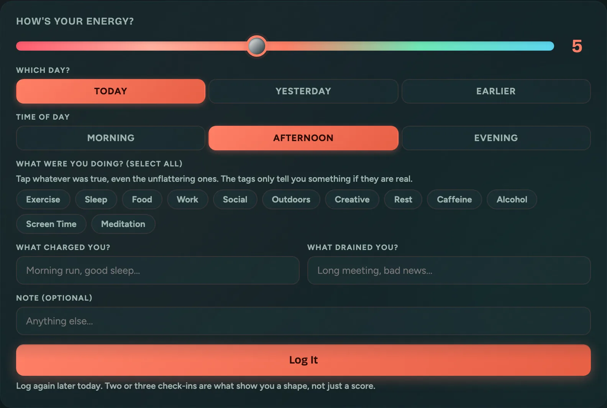
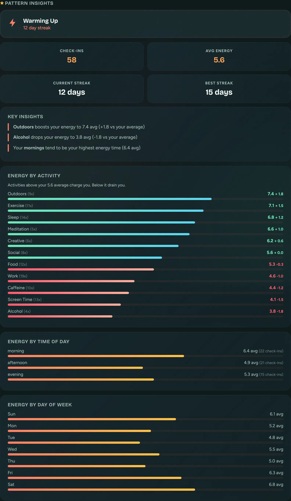

# Energy Battery 🔋

**An energy tracker that works like a phone battery.** Log how charged you feel a few times a day, tag what you were doing, and see what fills you up and what drains you. Glow the firefly keeps you company and her lantern fills with your day.

**[Start with a free plan at energybattery.app](https://energybattery.app)**. No setup, no card. Or run your own copy with the code in this repo.


---

## What it does

| Tab | What you get |
|---|---|
| **Check In** | The form. Rate your energy from 1 to 10, pick the time of day, tap what you were doing, and note what charged or drained you. Missed a day? Log it under Yesterday or Earlier, up to 30 days back. |
| **Battery** | Today at a glance: your level, how the day has gone, and your streak. A backup cell covers one missed day a week, so the streak keeps going. |
| **Log** | Your check-in history, newest first. |
| **Patterns** | Pro. Which activities line up with your good days and your crashes, your best time of day, your best day of the week, and a Recharge Menu of things that have worked for you before. |

It isn't a medical tool and doesn't diagnose anything. It also works on your phone, has a full how-to guide built in, and lets you export everything you've logged.

<p>


</p>

---

## Two ways to use it

### 1. Use the hosted version (easiest)

Go to **[energybattery.app](https://energybattery.app)** and sign up. The free plan gives you unlimited check-ins, the battery, the streak and the last 7 days of history. Nothing older is deleted, it's just tucked out of view. Pro opens your full history and the Patterns tab. Pro comes through the [Jen Built It App Hub](https://jenbuiltit.com/app-hub): $7 a month, $59 a year or $119 once, and one Pro covers all five apps in the hub. Paying for Pro is also how you support the project.

### 2. Run your own copy

**What a copy gives you:** your copy runs the free plan for everyone: unlimited check-ins, the battery, the streak and the last 7 days of history. Pro, with full history and Patterns, isn't sold on a copy. The **Go Pro** button opens a short note that Pro is part of the hosted version at energybattery.app, with no price and no checkout. To offer Pro on your own copy you connect your own Pro hub in Settings.

Energy Battery runs on Cloudflare Workers with a D1 database. You'll need [Node.js](https://nodejs.org) 22 or newer. Trying it on your own computer needs no Cloudflare account. Putting it online needs one, and a free account is enough.

**Try it on your computer:**

```bash
git clone https://github.com/jensoltys/energybattery.git
cd energybattery
npm install
cp .dev.vars.example .dev.vars
```

Open the new `.dev.vars` file and put a long random string after `JWT_SECRET=` (32 or more characters). `openssl rand -hex 32` prints a good one. Until that's set, sign up and log in answer "This server isn't set up yet".

```bash
npm run db:setup:local
npm run dev
```

Open `http://localhost:8787`. With `DEV_LOG_CODES=true` in `.dev.vars`, the 6-digit signup code and any password reset link print in your terminal, so you can test without setting up email. Running on a different port? Change `APP_URL` in `.dev.vars` to match, because the printed reset link uses it.

**To put it online:**

Create your database, then paste the `database_id` it prints into `wrangler.toml`:

```bash
npx wrangler d1 create energy-battery
```

Set `APP_URL` and `FROM_EMAIL` in `wrangler.toml` to your live address and your sender, so the very first emails carry the right links. Then:

```bash
npm run db:setup:remote
npx wrangler secret put JWT_SECRET
npx wrangler secret put RESEND_API_KEY      # signup codes and password resets
npm run deploy                              # runs the security scan, then deploys
```

Use `npm run deploy`, not `npx wrangler deploy`. Only the npm script runs the security scan first. A daily job (the `crons` line in `wrangler.toml`) clears out expired rate-limit rows and old reset and signup codes.

### Settings

| Setting | Needed? | What it's for |
|---|---|---|
| `JWT_SECRET` | **Yes** | Signs logins. The app refuses to start a session without a 32+ character secret. |
| `APP_URL` | **Yes** | Your site's address. Links in emails point here, and so do the link-preview and canonical tags on every page. |
| `APP_NAME` | Optional | The app's name in alert and feedback webhook messages. Set in `wrangler.toml`. |
| `RESEND_API_KEY` + `FROM_EMAIL` | For a live site | Sends signup codes and password resets through [Resend](https://resend.com). If `FROM_EMAIL` is blank, emails go out from Resend's test sender, `onboarding@resend.dev`, which only delivers to the email on your own Resend account. Set it to an address on a domain you've verified in Resend. |
| `ALERT_WEBHOOK_URL` + `ALERT_TOKEN` | Optional | Get a message when the server hits an error. |
| `SIGNUP_WEBHOOK_URL` + `SIGNUP_WEBHOOK_SECRET` | Optional | Get a message on each new signup. |
| `FEEDBACK_WEBHOOK_URL` | Optional | Where the in-app feedback button sends messages. Blank hides the Feedback button. |
| `PRO_LOOKUP_URL`, `PRO_REFRESH_URL`, `HUB_JWT_SECRET`, `HUB_LOOKUP_SECRET`, `RECAP_SERVICE_SECRET` | Optional | Connect a Pro hub like the one energybattery.app uses. Leave them blank and everyone is on the free plan. The three secrets need 32 or more characters each. A shorter one counts as not set, because a short secret would let anyone forge a login or Pro. |
| `UPGRADE_URL` | Optional, needs a hub | Where **Go Pro** sends people once your hub is connected (`HUB_JWT_SECRET` set). Must start with `https://` or `http://`. Blank hides Go Pro. |
| `PRO_PRICE_TEXT` | Optional, needs a hub | The price line in the Pro popup, like `$5 a month`. Blank shows no price. |

**Patterns and full history are Pro-only and need a Pro hub.** On a copy without one they stay locked for everyone, and the Log tab shows the last 7 days.

### Before you run it publicly

Replace these before you go public:

- [ ] `YOUR COMPANY NAME`, `YOUR BUSINESS ADDRESS` and the contact emails in `public/legal/`, the page footers and `EMAIL_SENDER_LINE` in `src/worker.js` (it goes at the bottom of every email).
- [ ] `YOUR STATE` and `YOUR COUNTY` in `public/legal/terms.html` (governing law and courts).
- [ ] The source code link in the footers and in `public/legal/terms.html`, if you run a changed version (the AGPL asks you to offer your own code).
- [ ] The lines in `public/legal/` that depend on your setup: Cloudflare Web Analytics and the optional webhooks in `privacy.html`, and the line marked `EDIT THIS LINE` in `accessibility.html`.
- [ ] The Pro lines marked `EDIT OR DELETE THIS if your copy has no Pro hub` in `public/legal/terms.html` (sections 1 and 4). They describe buying Pro through a hub with Stripe. Rewrite them for how your copy sells Pro, or delete them if it doesn't. The Pro hub items in `public/legal/privacy.html` say "if this site connects one", so check they still fit.
- [ ] `YOUR-DOMAIN` in `public/robots.txt` (uncomment the Sitemap line once you have one).
- [ ] `public/.well-known/security.txt`: the `security@example.com` contact, the `example.com` address and the `Expires` date.
- [ ] `public/og.png`, the social share image. It shows energybattery.app. The tags that point to it use your `APP_URL`, so you only swap the picture.

Pro is part of the hosted version. On a copy with no Pro hub connected, every **Go Pro** button opens a short note that Pro lives on energybattery.app. No price or billing line shows, so nobody pays for something that won't work on your copy. Once you connect your own hub, **Go Pro** goes to your `UPGRADE_URL` and the popup shows your `PRO_PRICE_TEXT`. Leave `UPGRADE_URL` blank and Go Pro stays hidden. The app also shows a daily tip that links to my other apps and posts. They're in the `GENERAL_NUDGES` list in `public/app.js`. No affiliate links ship in this repo.

### Keep your copy as safe as energybattery.app

Your copy is built from the same source as energybattery.app, with the hosted site's own hookups turned into optional settings. So it gets the same protections: hashed passwords, a lockout after 5 wrong passwords, a limit on signup-code guesses, reset links that die once one is used, and checks that block requests from other websites. Logging out clears the session on that device, and changing or resetting the password signs out every device. A few of those depend on your setup:

- [ ] **Use a long random `JWT_SECRET`.** The app won't log anyone in without one of 32+ characters. `openssl rand -hex 32` makes a good one. The same goes for the Pro hub secrets if you connect a hub.
- [ ] **Set up email before going live** (`RESEND_API_KEY` and `FROM_EMAIL`). Never set `DEV_LOG_CODES` on a live site.
- [ ] **Keep secrets out of git.** Store them with `npx wrangler secret put`, never in `wrangler.toml`. `.dev.vars` is already ignored.
- [ ] **Stay updated.** Security fixes made on energybattery.app get copied here. Click **Watch** at the top of this page to hear about them, then pull and redeploy.

Found a security problem? See [SECURITY.md](SECURITY.md).

---

## Tests

```bash
npm test                # unit tests
npm run test:security   # scans for common security mistakes
```

## Made by

**Jen Soltys**. I build small apps that fix everyday annoyances at **[Jen Built It](https://jenbuiltit.com)** and write about building with AI at **[jen8n.com](https://jen8n.com)**.

If Energy Battery helps you, the best support is a **[Pro plan](https://jenbuiltit.com/app-hub/upgrade?from=battery)** or a ⭐ on this repo.

## Contributing

Bug reports and ideas are welcome in [Issues](../../issues). I'm not taking pull requests right now, which keeps the commercial license option possible. You're free to fork it and make it yours under the license below. See [CONTRIBUTING.md](CONTRIBUTING.md) and the [code of conduct](CODE_OF_CONDUCT.md).

**Getting help:** self-hosted copies are community-supported. You run your copy, so you handle its setup, updates, backups and security. [SUPPORT.md](SUPPORT.md) says where to ask.

## License

[AGPL-3.0](LICENSE). You can use, change and share Energy Battery. If you run a changed version as a website for other people, you have to share your changed code under the same license.

### Commercial license

Want to build Energy Battery into a product without sharing your code, or run a changed version for customers without publishing your changes? You can buy a commercial license that replaces the AGPL terms for your business. Email **hello@jenbuiltit.com** with what you're building.

## Trademarks

The license covers the code, not the name. "Energy Battery", its logo, Glow the firefly and its look aren't licensed for your own product. If you run a changed copy for other people, give it your own name and branding. Saying it's "powered by Energy Battery" is fine. Don't present your copy as the original or as run or endorsed by Jen Built It.
